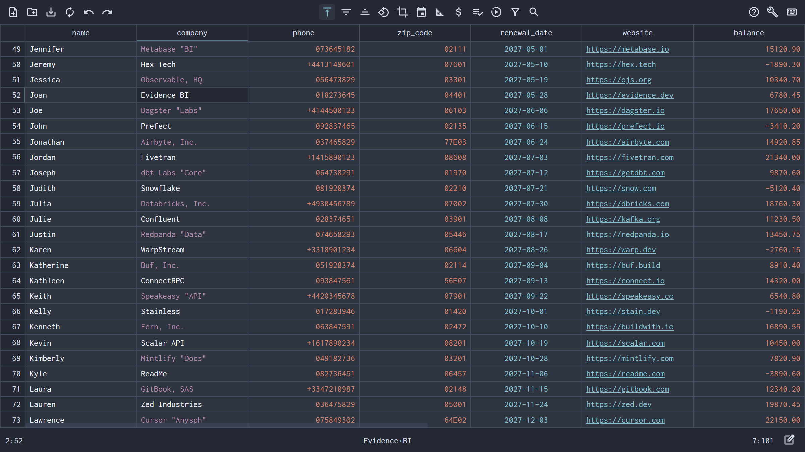

> 🚀 **Launch Live in Your Browser:** **[nanocell-csv.com/app/home.html](https://nanocell-csv.com/app/home.html)** · 🧪 **[Try Interactive Sample Data](https://nanocell-csv.com/app/home.html?sample=base-sample.csv)**
> *(100% client-side, zero telemetry, installs in 1 click as an offline Desktop PWA with zero admin rights).*

  

---

## ✨ What's New in `v1.2.2`

### 🛡️ Verbatim Engine & RFC 4180 Fidelity
- **Preserve Quoted Empty Strings (`""` vs `NULL`)**: Added an optional setting (*Settings → Csv Open → Preserve quoted empty strings (`""`)*) to keep `,,` (`NULL`) and `,"",` (empty string) distinct during SQL/PostgreSQL round-trips, complete with a visual `empty string` cell badge and quick insertion via the right-click context menu or Command Palette.
- **Smart UTF-8 Encoding Fallback**: Improved character encoding detection with seamless UTF-8 fallback alongside `UTF-16LE/BE`, `Shift-JIS`, `GB18030`, and `Windows-1251/1252`.
- **SQL Header Sanitizer Polish**: Trims outer underscores from sanitized column names so headers like `"(Customer Name!)"` cleanly become `customer_name` (#38).

### ⚡ Workflow, UX & Performance
- **1-Click Interactive Sample CSV (`?sample=base-sample.csv`)**: Test NanoCell's verbatim text engine, RFC 4180 highlighting, and 19+ cleaners immediately in the browser with a preloaded dataset.
- **In-Tab File Open & Unsaved-Changes Guard**: Opening local files now loads directly in the active workspace with a safety prompt preventing accidental loss of unsaved edits.
- **File Info Drawer & Read-Only Lock Bounds**: Quickly inspect file metadata, encoding, delimiter, and row/column counts, and safely lock large or sensitive tables in View-Only mode.
- **Context-Aware HTML & Multi-Line Clipboard**: Copy and paste across cells without broken wizard dialogs or unwanted type reformatting.
- **Reusable Cleanup Macros (<kbd>Ctrl</kbd>+<kbd>Shift</kbd>+<kbd>M</kbd>)**: Chain multiple data-cleaning steps (header sanitization, currency splitting, locale number normalization, bulk replacements) into a single repeatable keystroke.

---

## 📦 Attached Release Artifacts

While most users run NanoCell directly at **[nanocell-csv.com](https://nanocell-csv.com)** or as an installed **Desktop PWA**, this release includes two standalone archives:

1. **`nanocell-csv-v1.2.2-offline-static.zip`** — Pre-built static web application (`dist/`). Ideal for air-gapped networks, corporate intranets, or running locally via any static file server (`npx serve` or `python3 -m http.server 8080`) without Node.js or a build step.
2. **`nanocell-csv-sample-pack.zip`** — Curated CSV test suite (`base-sample.csv` + multi-MB UTF-8/BOM/ISO stress-test files) for testing leading zeros, international phone numbers, RFC 4180 escaping, and large-file sampling.
