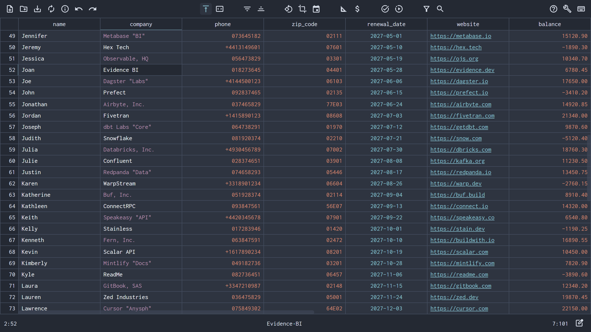

> 🚀 **Launch Live in Your Browser:** **[nanocell-csv.com/app/home.html](https://nanocell-csv.com/app/home.html)** · 🧪 **[Try Interactive Sample Data](https://nanocell-csv.com/app/home.html?sample=base-sample.csv)**
> *(100% client-side, zero telemetry, installs in 1 click as an offline Desktop PWA with zero admin rights).*

  

---

## ✨ What's New in `v1.3.1`

### 🛡️ Editable File Dialect & Round-Trip Fidelity
- **Preserve & Edit File Dialect (<kbd>Ctrl</kbd>+<kbd>I</kbd>)**: Detected file encoding, delimiter, line endings (`CRLF`/`LF`), and `UTF-8`/`UTF-16` BOM are now preserved on save by default, and can be inspected, modified, or re-parsed on the fly from the revamped **File Info** drawer and Command Palette.

### ⚡ Adaptive Grid Layout, Column Sizing & Editing UX
- **Responsive Grid Sizing (`auto` / `manual`) & Smart Column Widths (`equal` / `smart`)**: Added viewport-responsive grid sizing (`auto` by default) and `O(1)` content-aware `smart` column widths, plus dynamic `.row-header` scaling for multi-million-row files.
- **Display All Columns (<kbd>Ctrl</kbd>+<kbd>Alt</kbd>+<kbd>F</kbd>) & Header Spotlight**: Fit all table columns (+1 trailing column) in a single click via the new `fit_width` toolbar action (toggling back to `auto` on repeat), double-click any column header to spotlight up to `50%` width without collapsing neighbors, or double-click the top-left corner cell to toggle `smart` / `equal` column widths.
- **Duplicate Rows & Columns + Redo Repeat**: Quickly duplicate selected rows or columns from the right-click context menu or Command Palette, with full undo/redo repeat support.

### 🌐 Modern Desktop PWA Support
- **Web Install API & Expanded Browser Support**: Integrated `navigator.install()` alongside `beforeinstallprompt`, added desktop PWA install guidance for **Firefox 143+ (Windows)** and **Safari 17+ (macOS)**, and added a *"Do not show again"* toggle on the browser capability notice.

---

## 📦 Attached Release Artifacts

While most users run NanoCell directly at **[nanocell-csv.com](https://nanocell-csv.com)** or as an installed **Desktop PWA**, this release includes two standalone archives:

1. **`nanocell-csv-v1.3.1-offline-static.zip`** — Pre-built static web application (`dist/`). Ideal for air-gapped networks, corporate intranets, or running locally via any static file server (`npx serve` or `python3 -m http.server 8080`) without Node.js or a build step.
2. **`nanocell-csv-sample-pack.zip`** — Curated CSV test suite (`base-sample.csv` + multi-MB UTF-8/BOM/ISO stress-test files) for testing leading zeros, international phone numbers, RFC 4180 escaping, and large-file sampling.
