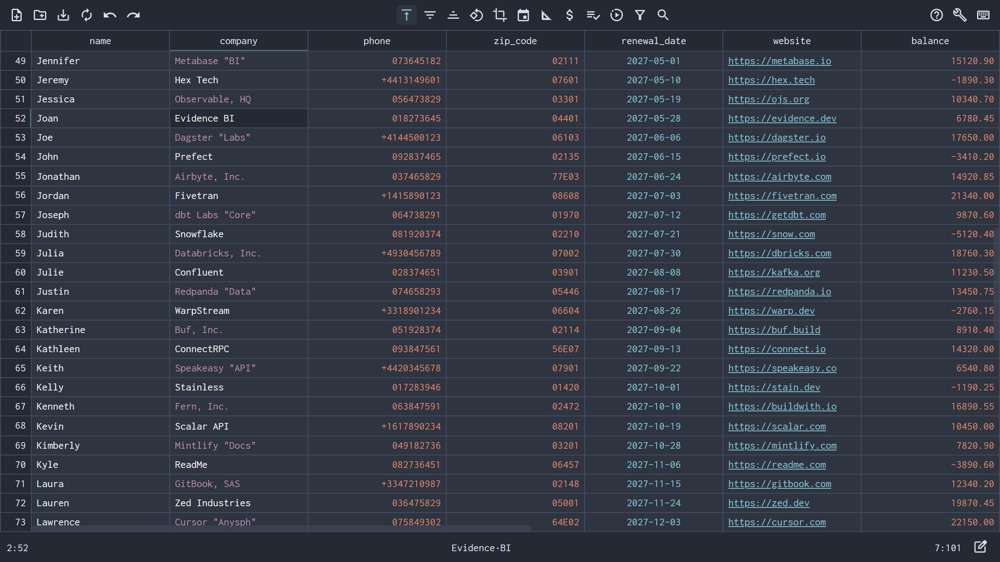
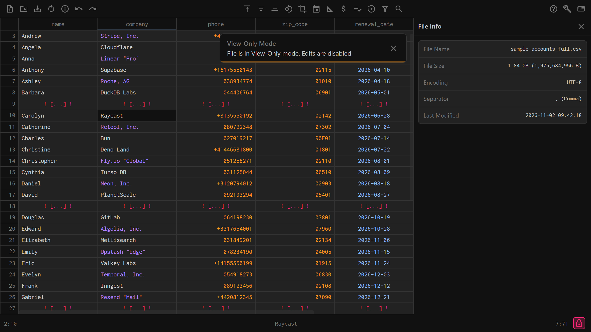
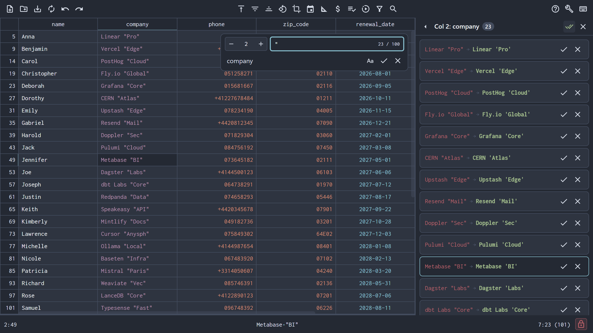
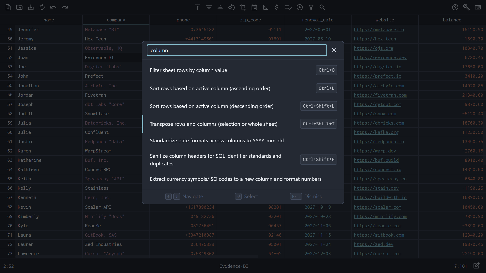
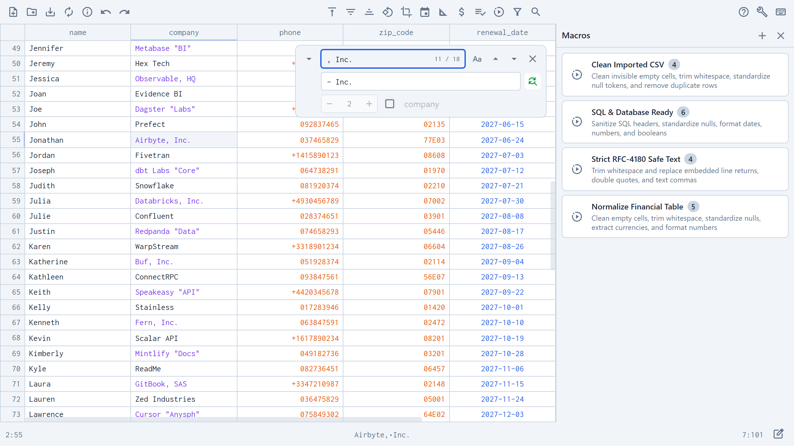

<div align="center">

<a href="https://nanocell-csv.com">
  
</a>

# NanoCell CSV

### **The CSV Editor That Never Corrupts Your Data.**

**100% Verbatim Text Accuracy · Instant `O(1)` Multi-GB Previews · 19+ One-Click Cleaners · 100% Offline & Client-Side**

[](https://nanocell-csv.com/app/home.html)
[](https://nanocell-csv.com/app/home.html?sample=base-sample.csv)
[](https://github.com/CedricBonjour/nanocell-csv/stargazers)

[](https://nanocell-csv.com)
[](https://nanocell-csv.com)
[-0ea5e9?style=flat-square)](#quick-start)
[](https://github.com/CedricBonjour/nanocell-csv/releases)

<p>
  <a href="https://nanocell-csv.com/app/home.html"><b>🚀 Launch Editor</b></a> •
  <a href="https://nanocell-csv.com/app/home.html?sample=base-sample.csv"><b>🧪 Try Sample Data</b></a> •
  <a href="#why-nanocell">Why NanoCell</a> •
  <a href="#features">Visual Tour</a> •
  <a href="#power-tools">19+ Cleaners</a> •
  <a href="#compare">Comparison</a> •
  <a href="#quick-start">Install (No Admin)</a>
</p>

<a href="https://nanocell-csv.com/app/home.html?sample=base-sample.csv">
  
</a>

</div>

| ⚡ `50ms` for 5 GB+ Files | 🎯 `100%` Verbatim Text | 🔒 `0 Bytes` Uploaded | 🧹 `19+` Built-In Cleaners |
| :--- | :--- | :--- | :--- |
| Instant `O(1)` preview via background Web Worker interval sampling | `"02138"` stays `"02138"`. Zero silent type-casting or precision loss | Runs 100% in local memory. Works offline in airplane mode | One-click sanitizers for SQL headers, currency, locale numbers & dates |

> [!TIP]
> **Tired of Excel silently mangling your CSV exports?** [**⭐ Star this repository**](https://github.com/CedricBonjour/nanocell-csv) to bookmark **NanoCell CSV** for the next time you need to inspect a multi-gigabyte dump or edit a production CSV without breaking leading zeros, dates, or IDs.

---

<a id="why-nanocell"></a>

## 💥 The Spreadsheet Trap (Why NanoCell Exists)

Traditional spreadsheets (`Excel`, `Numbers`, `Calc`) guess data types the instant you open a CSV—silently destroying database keys, postal codes, international phone numbers, and dates **before you even press save**.

**NanoCell CSV** is engineered from the ground up for software engineers, data analysts, and database administrators who need CSVs handled for what they actually are: **structured verbatim text**.

| Data Category | Raw CSV Value | ❌ Standard Spreadsheets (On Open & Save) | ✅ NanoCell Verbatim Engine |
| :--- | :--- | :--- | :--- |
| **Postal / ZIP Codes** | `"02138"` | `2138` — *Strips leading zero as integer; breaks address validation* | **`02138`** — *Preserved character-for-character* |
| **International Phones** | `"+41 79 123 45 67"` | `#NAME?` or `41791234567` — *Interprets leading `+` as a broken formula* | **`+41 79 123 45 67`** — *Never evaluates `+` or `-` as formulas* |
| **ISO & Regional Dates** | `"2026-03-04"` | `3/4/26` or `04/03/2026` — *Rewrites to OS locale or flips `DD/MM` & `MM/DD`* | **`2026-03-04`** — *Exact date string preserved without locale roulette* |
| **SKU & Gene / Part IDs** | `"84E02"` / `"10-12"` | `8.40E+03` / `12-Oct` — *Casts alphanumeric codes into floats or dates* | **`84E02` / `10-12`** — *Zero unwanted scientific or calendar casting* |
| **64-bit / Snowflake / Stripe IDs** | `"9007199254740993"` | `9007199254740990` — *IEEE-754 float precision permanently zeroes last digits* | **`9007199254740993`** — *Unlimited-length string fidelity* |
| **SQL `NULL` vs Empty String `""`** | `,,` vs `,"",` | Collapses both into identical blank cells on export | **Optional strict distinction** with visual `empty string` badge |

---

<a id="features"></a>

## ✨ Core Architecture & Visual Tour

### 1. ⚡ Instant `O(1)` Multi-Gigabyte File Preview

Need to know what is inside a **5 GB+ CSV or TSV dump** before spinning up `pandas`, `PySpark`, or `DuckDB`?
NanoCell samples the **header**, **evenly spaced interval chunks**, and the **footer** inside a background Web Worker in milliseconds—without loading the entire file into RAM—while engaging a safe **View-Only lock** so massive files never freeze your machine.

<div align="center">
  
</div>

---

### 2. 🧹 Import-Ready in One Click (19+ Cleaners & RFC 4180 Validator)

Turn messy vendor exports into clean, database-ready tables in seconds. Open the **Validation & Cleaning Pane** to inspect and fix structural or formatting issues across an entire column or table with a single click:

- **SQL Header Sanitizer**: Converts messy headers (`"Customer Name (USD)!"`) into clean `snake_case` SQL identifiers (`customer_name_usd`).
- **Currency & ISO-4217 Splitter**: Strips or splits `$`, `€`, `£`, `CHF`, and currency codes away from numeric columns.
- **Locale & Accounting Number Normalizer**: Converts `1.234,56`, `1'234.56`, and `(450.00)` accounting negatives into standard decimal notation.
- **Duplicate Row Detector & Null/Error Cleaner**: Highlights duplicate records and cleans `#N/A`, `null`, `NaN`, or stray whitespace.
- **Strict RFC 4180 Save Guard**: Visually highlights unescaped quotes and delimiters in purple and guarantees strict RFC 4180 compliance on save.

<div align="center">
  
</div>

---

### 3. ⌨️ Keyboard-First Fuzzy Command Palette & Multi-Format Export

Everything in NanoCell is accessible without lifting your hands from the keyboard. Trigger the **Fuzzy Command Palette** to run transforms, jump to coordinates, switch encodings (`UTF-8`, `UTF-16LE/BE`, `Shift-JIS`, `GB18030`, `Windows-1251/1252`), auto-detect delimiters (`,`, `;`, `TAB`, `|`), transpose matrices, or export directly to **JSON**, **GitHub Markdown tables**, or **TSV**.

<div align="center">
  
</div>

---

### 4. 🔁 Reusable Cleanup Macros (<kbd>Ctrl</kbd>+<kbd>Shift</kbd>+<kbd>M</kbd>) & Bulk Find/Replace

Have a recurring vendor CSV that needs the same 5 cleanup steps every Monday? Chain sanitizers, header transforms, and replacements into a **reusable Cleanup Macro** and execute your entire pipeline in a single keystroke.

<div align="center">
  
</div>

---

<a id="power-tools"></a>

## 🛠️ Complete Feature Arsenal

| 🧹 Data Cleaning & Validation | ⚡ Power Editing & Transforms | 🧭 Navigation, I/O & UX |
| :--- | :--- | :--- |
| • **SQL Header Sanitizer**<br>• **Currency & ISO-4217 Splitter**<br>• **Locale & Accounting Numbers**<br>• **RFC 4180 Field Sanitizers**<br>• **Duplicate Row Detector**<br>• **Null & Error Cleaner**<br>• **Strict RFC 4180 Save Guard**<br>• **Empty Row & Col Trimmer**<br>• **Preserve `""` vs `NULL` Round-Trip** | • **Reusable Cleanup Macros**<br>• **Matrix Transposition**<br>• **JSON, GitHub Markdown & TSV Export**<br>• **In-Place Number Rounding**<br>• **Series Auto-Expansion**<br>• **Row/Col Shift & 4-Way Insert**<br>• **Find & Bulk Replace**<br>• **Instant ISO Date Stamp**<br>• **Multi-Step Undo & Redo** | • **Instant `O(1)` Multi-GB Preview**<br>• **Auto Encoding Detection**<br>• **Auto Delimiter Detection (`,`, `;`, `TAB`, `\|`)**<br>• **Smart Cell Syntax Highlighting**<br>• **Fuzzy Command Palette**<br>• **Fast Column Sorting & Filtering**<br>• **Freeze Header Row & Occurrence Jump**<br>• **Coordinate Jumper**<br>• **7 Built-In Themes (Dark & Light)** |

---

<a id="compare"></a>

## 📊 How NanoCell Compares

Purpose-built for raw delimited data where spreadsheets over-format and raw text editors under-structure:

| Capability | **NanoCell CSV** | Excel / LibreOffice Calc | Online Cloud CSV Editors | Raw Text Editors (VS Code) |
| :--- | :---: | :---: | :---: | :---: |
| **Preserves leading zeros & `+` signs verbatim** | ✅ **Always (100% Verbatim)** | ❌ Silently strips / casts | ⚠️ Varies | ✅ Yes |
| **RFC 4180 Compliance & Delimiter Guard** | ✅ **Visual warnings + Strict Save** | ⚠️ Locale-dependent quirks | ⚠️ Varies | ❌ Easy to break column alignment |
| **Opens 5 GB+ CSVs in milliseconds** | ✅ **`O(1)` Interval Sampling** | ❌ Freezes / Truncates at 1M rows | ❌ Browser upload crashes | ⚠️ Slow / High RAM |
| **100% Offline & Zero Server Uploads** | ✅ **100% Client-Side PWA** | ✅ Local Desktop | ❌ Uploads sensitive data to cloud | ✅ Local Desktop |
| **1-Click SQL Header, Currency & Locale Cleaners** | ✅ **Built-in Validation Pane** | ❌ Manual formulas required | ❌ Rare / Paid tiers | ❌ Manual regex required |
| **Reusable Cleanup Macros** | ✅ **Built-in (<kbd>Ctrl</kbd>+<kbd>Shift</kbd>+<kbd>M</kbd>)** | ⚠️ Complex VBA / Scripts | ❌ No | ❌ External scripts |
| **Installs on Locked Corporate Laptops (No Admin)** | ✅ **1-Click Browser / PWA** | ❌ Requires IT license / install | ✅ Browser-based | ❌ Requires `.exe` / `.dmg` installer |

---

<a id="quick-start"></a>

## 🚀 Quick Start & Installation

### 1. Instant Browser Launch (Zero Install)
Open NanoCell directly in your browser—no account, no backend server, and zero telemetry:
- 👉 **[Launch Empty Editor (`nanocell-csv.com/app/home.html`)](https://nanocell-csv.com/app/home.html)**
- 🧪 **[Launch with Interactive Sample CSV](https://nanocell-csv.com/app/home.html?sample=base-sample.csv)**

### 2. Install as an Offline Desktop App (PWA — Zero Admin Rights)
Working on a locked-down corporate laptop where `.exe` or `.dmg` installers are blocked by IT?
1. Open **[nanocell-csv.com](https://nanocell-csv.com)** in **Chrome**, **Edge**, or **Brave**.
2. Click **Install** in the top navigation bar (or the install icon in your browser's address bar).
3. NanoCell installs as a **standalone offline desktop application** with native OS file associations—double-click any local `.csv` or `.tsv` file to open it directly in NanoCell, even in airplane mode.

### 3. Run & Build Locally from Source
NanoCell CSV is built with vanilla TypeScript/JavaScript, Web Workers, and Vite—with **zero runtime dependencies** so you can audit and verify its 100% local execution yourself.

```bash
# Clone the repository
git clone https://github.com/CedricBonjour/nanocell-csv.git
cd nanocell-csv

# Install build dependencies
npm install

# Start the local development server
npm run dev

# Build static production bundle into dist/
npm run build
```

---

<a id="guides"></a>

## 📚 Deep-Dive CSV Engineering Guides

Learn more about CSV internals, encoding pitfalls, and database import workflows from our engineering guides:

- 📖 **[Why Excel Corrupts CSV Files (And How to Stop It)](https://nanocell-csv.com/article/why-excel-corrupts-csv-files.html)**
- 📖 **[How to Edit CSV Files Without Losing Leading Zeros](https://nanocell-csv.com/article/edit-csv-without-losing-leading-zeros.html)**
- 📖 **[How to Clean & Sanitize CSV Files for SQL Database Import](https://nanocell-csv.com/article/clean-csv-for-sql-database-import.html)**
- 📖 **[How to Open & Preview Multi-Gigabyte CSV Files Instantly](https://nanocell-csv.com/article/open-large-csv-files.html)**
- 📖 **[Fixing Broken CSV Character Encodings (`UTF-8`, `Shift-JIS`, `Windows-1252`) & Delimiters](https://nanocell-csv.com/article/fix-csv-encoding-and-delimiters.html)**
- 📖 **[Free Offline CSV Editor & RFC 4180 Validator](https://nanocell-csv.com/article/free-offline-csv-editor-and-validator.html)**

---

<a id="contribute"></a>

## 🤝 Support & Contribute

NanoCell CSV is free, 100% client-side, and actively shaped by real-world CSV edge cases from software engineers and data practitioners.

- ⭐ **Star & Bookmark on GitHub**: If NanoCell saves you from spreadsheet data corruption, **[give the repo a Star](https://github.com/CedricBonjour/nanocell-csv)**! Starring helps other developers discover a privacy-first CSV tool and keeps it in your GitHub bookmarks for your next data task.
- 🐛 **Submit Tricky CSV Edge Cases**: Have a malformed CSV with wild escaping, mixed encodings, or unusual delimiters? **[Open an issue on the GitHub Issue Tracker](https://github.com/CedricBonjour/nanocell-csv/issues/new)**.
- 💡 **Request Cleaners & Transforms**: Need a domain-specific validation rule, sanitizer, or export format? **[Suggest a feature on GitHub Issues](https://github.com/CedricBonjour/nanocell-csv/issues)**.
- 📣 **Share with Your Team**: Drop a link to **[nanocell-csv.com](https://nanocell-csv.com)** in your team's `#data` or `#engineering` channel, or share it on Reddit, Hacker News, and X/Twitter!

---

## 📄 License & Terms

Copyright © Cedric Bonjour. Please see [LICENSE.md](LICENSE.md) and [TERMS_OF_USE.md](TERMS_OF_USE.md) for license and usage details.

<div align="center">
  <br />
  <a href="https://nanocell-csv.com/app/home.html"><b>Launch NanoCell CSV</b></a> •
  <a href="https://nanocell-csv.com"><b>Website</b></a> •
  <a href="https://github.com/CedricBonjour/nanocell-csv/issues"><b>Report a Bug</b></a>
  <br /><br />
  <sub>If you find NanoCell CSV useful, please consider giving the repository a ⭐ on <a href="https://github.com/CedricBonjour/nanocell-csv">GitHub</a>!</sub>
</div>
