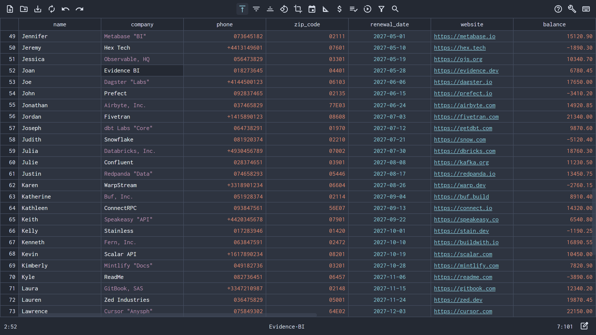

# Nanocell - CSV

A free csv file viewer and editor.

App download availabale on the website : [https://nanocell-csv.com](https://nanocell-csv.com)

- fast
- simple
- lightweight
- cross platform
- PWA (Progressive Web App)
- quick-view large files
- works 100% offline
- custommizable
- free

## Built for speed and simplicity
Nanocell-csv lets you edit and visualize CSV files instantly, from massive datasets to small configuration tables. It guarantees your data stays safe and accurate by avoiding to interpret data types. Designed by and for data experts, Nanocell-csv delivers precision and performance you can trust.

Nanocell-csv aims to be the go-to CSV editing tool for software engineers and data experts worldwide.

## Key features

**Data privacy** - Nanocell-csv works 100% off-line, your data is never leaving your computer. Nanocell-csv.com runs on a static server which, by design, only sends data on request but cannot register any data. This is very easy for the anyone to validate as the source code is available [here](https://github.com/CedricBonjour/nanocell-csv).

**Data accuracy** - CSV data is text and Nanocell-csv makes sure values are being handled as such. Leading zeros and '+' signs are kept. No more data corruption of phone numbers, zipcodes, etc. Pasting data also finally works as you would expect, no more paste reformatting or column split action to perform !

**Instant view large files** - O(1) 😉. This is achieved by sampling the header, the footer and a few rows at regular intervals without parsing the entire file. The goal here is for data experts to quickly understand what they are dealing with when first opening a file. That is before they start using heavier Big-Data tools like pandas, pyspark, powerBI, R etc...

## Contribute

**Grow the community** - Star the github repo and talk about Nanocell-csv to people around you! Link it on relevant reddit posts or show how useful its been to you on social media!

**Give feedback: missing features & bugs** - Nanocell-csv still has a bit to go before being stable and mature. Help us get there faster by reporting on the github issue tracker.

